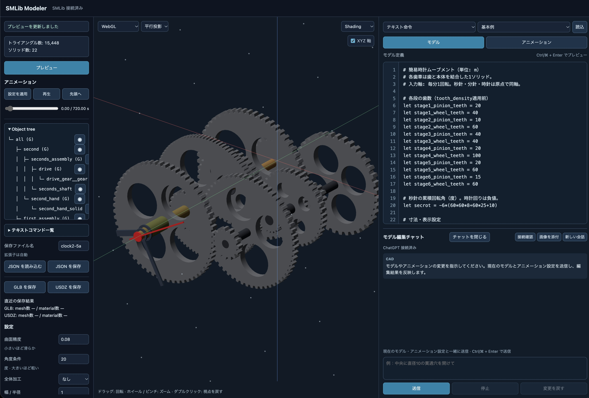

# SMLib Modeler

テキスト命令または Python コードで3Dモデルを作成し、ブラウザで形状や動きを確認できるローカルCADアプリです。Macでサーバーを起動し、同じMacやLAN内の端末から利用できます。



## 主な機能

- **モデル作成**：プリミティブ、断面の押し出し・回転、Boolean演算、面取り・丸め、オフセット・シェルで形状を作成できます。変数・計算関数・繰り返し、部品の再利用、グループ階層と変換にも対応します。
- **プレビュー**：材質を設定し、WebGLで平行／透視投影、陰影、ワイヤーフレーム、面法線を確認できます。対応するSafariではUSDZの `<model>` プレビューも利用できます。
- **アニメーション**：グループの移動・回転・拡縮をキーフレームで定義し、ループ再生できます。数式や繰り返しを使って動きを記述し、GLB・USDZへ書き出せます。
- **チャット編集**：ChatGPTに自然言語や参考画像で指示し、モデルとアニメーションを編集できます。生成エラーの自動修正や、変更の取り消しにも対応します。
- **保存と書き出し**：ソース・設定・会話履歴をJSONで保存・復元し、表示用モデルをGLB・USDZで出力できます。編集中のソースと設定はブラウザに自動保存され、保存済みJSONはCLIからも変換できます。

## SMLib の利用

NVIDIAが公開しているCADカーネル SMLib で BRep の作成、Boolean 演算、面取り・丸め、テッセレーションを行います。`usd-brep` 内の `SMLib` と `SM_API` を `_smlib_core` に直接組み込みます。Python API の引数・戻り値・所有権は [ツール境界 API 仕様](usd-brep/docs/smlib-core-tool-api.md) を参照してください。

形状生成とテッセレーションには、同梱の `usd-brep` ソースから作る **USD 非依存** の `_smlib_core` Python 拡張を使います。USDZ はテッセレーション済みメッシュから直接生成し、`pxr` API は使いません。

`_smlib_core` はプリミティブに加え、Boolean、全エッジ加工、`face_info`、`offset_brep`、`shell_brep`、`transform_brep`、`tessellate` を公開します。

## ビルドと起動（Apple Silicon）

このフォルダーで実行します。Xcode Command Line Tools、Python 3.12（開発用ヘッダーを含む）、`uv` と pybind11 2.11.1 が必要です。`Makefile` は `usd-brep` 内の `SMLib`・`SM_API`・`SmPyCore` のソースをコンパイルし、arm64 用の単一 Python 拡張 `_smlib_core` を作ります。

```bash
uv pip install --target .deps/pybind11 pybind11==2.11.1
make start
```

`Makefile` は `.packman-cache/python/` に Python 3.12 があればそれを再利用し、なければ PATH 上の `python3.12` を使います。別の Python 3.12 を使う場合は `make start PYTHON=/path/to/python3.12` を指定します。Packman・Premake・OpenUSD のインストールは、このツールのビルドには必要ありません。

`make start` は必要なネイティブ拡張とローカルHTTPS証明書を用意し、全IPv4インターフェース（`0.0.0.0`）でサーバーを起動します。`make start-https` も同じ起動方法です。このMacでは `https://localhost:8765`、同じLAN内の端末では `https://<MacのLAN内IPv4アドレス>:8765` を開きます。MacのIPv4アドレスは「システム設定 → ネットワーク」で確認できます。停止は起動した端末で Ctrl+C を押します。

ポートを変えるには `make start PORT=8766` を指定します。HTTPが必要な場合は `make start-http` を使いますが、USDZ の `<model>` プレビューには信頼済みHTTPS接続が必要です。以下のテスト・サンプル中の `python3.12` も、ビルドに使った Python の実行ファイルに合わせてください。

このMacからのみアクセスできるようにする場合は、待ち受け先を明示します。

```bash
make start HOST=127.0.0.1
```

通常起動では、LANからアクセスした端末もPythonコードを実行できます。認証はないため、信頼できるLANだけで使い、ルーターのポート転送などでインターネットに公開しないでください。macOSのファイアウォールが接続を確認した場合は、利用するネットワークでの着信を許可する必要があります。

Web 画面のプレビュー・GLB・USDZ 生成はリクエストごとに別プロセスで実行します。形状カーネルが異常終了してもサーバは動作を続け、画面に生成エラーを表示します。計算が 60 秒を超えた場合は計算プロセスを終了してエラーを返します。左ペイン上部のメッセージ欄と設定のスクロール欄は独立しており、計算中やエラー時も設定を操作できます。

### HTTPS と USDZ の `<model>` プレビュー

初回起動時に `.certs/` にローカルCAとサーバー証明書を生成します。証明書には `localhost`、`127.0.0.1`、起動時に検出したMacのIPv4アドレスを含めます。別のLANアドレスを追加する場合は `make start CERT_IP=192.168.1.20` と指定してください。CAは保持し、必要なアドレスが増えた場合はサーバー証明書のみ更新します。

接続するApple端末には `.certs/local-ca.mobileconfig` をAirDropなどで渡してインストールし、SSL/TLS用に信頼してください。iPhone・iPad・Vision Proではインストール後に「設定 → 一般 → 情報 → 証明書信頼設定」でルート証明書の完全な信頼を有効にします。Macでは `.certs/local-ca.crt` をキーチェーンに追加して信頼します。`.certs/local-ca.key` と `.certs/server.key` は共有しないでください。これらはGitの対象外です。

画面右側の「プレビュー方式」で「USDZ `<model>`」を選ぶと、現在のモデルを「保存時の座標倍率」を適用したUSDZとして再計算し、同じサーバーから配信して表示します。「プレビュー」でも再計算できます。対応していないブラウザや信頼済みHTTPSでない接続ではWebGL表示を使ってください。`<model>` は対応版のSafariで動作し、表示・操作はブラウザ側に委ねられます。

## チャットでモデルを編集

右ペイン下部の「モデル編集チャット」に指示すると、現在のモデルソース・アニメーション設定全文・入力モード・モデルのパラメータを Codex 経由で GPT に送ります。モデルとアニメーションの編集結果を個別に受け取り、各エディタへ反映します。モデルや共有の `let` を変更した場合は再プレビューし、キーやトラックだけの変更は生成済みのWebGLメッシュへ適用します（初回メッシュ生成前やUSDZプレビューでは再プレビューします）。テキスト命令と Python の両方に対応します。質問への回答だけの場合はモデル・アニメーション設定を変更しません。応答の各ソースフィールドは `null` が現状維持、`animationSource: ""` がアニメーション設定削除を意味します。未完成・構文エラーのアニメーション設定もチャットへ送って修正を依頼できます。

チャット見出しの「チャットを閉じる」でエリアを折りたたむと、その分エディタが縦に広がります。「チャットを開く」で戻せます。会話履歴や入力内容は保持され、応答中の処理も継続します。

「画像を添付」で参考画像・図面・スクリーンショットを選択できます。PNG・JPEG・WebPを1回に3枚まで、各2 MiB以下で添付でき、送信前にサムネイルを確認・削除できます。画像だけを添付して送信することもできます。画像は指示と現在のソースに添えてGPTへ渡し、履歴にも表示します。画像だけでは確定できない実寸はGPTから確認するよう指示しています。

添付画像は会話の `images`（`name` と `dataUrl`）としてモデルJSONにも保存・復元します。保存する履歴内の画像データはbase64形式で合計12 MB、モデルJSON全体は16 MBまでです。復元した履歴の画像は、次の送信時に画像入力としてCodexへ渡し直します。サーバーは画像形式・サイズを検査し、Codexの一時作業フォルダーへ画像を展開して渡し、処理終了時に削除します。

GPTへの指示では、実寸を想定するモデルの座標・寸法は **1 = 1 m** とし、mm・cmで指定された寸法はmへ換算してソースに記述させます（例：10 mm → 0.01）。

サーバーのMacに Codex CLI、または CLI を同梱する ChatGPT / Codex アプリが必要です。PATH 上の `codex`、次にアプリ内のCLIを検出します。別の場所にある場合は起動時に `CAD_CODEX_BIN=/absolute/path/to/codex make start` を指定します。モデルは Codex の既定値を使い、必要なら `CAD_CODEX_MODEL=<利用可能なモデルID> make start` で指定できます。

1. `make start` で起動し、ブラウザで開きます。
2. チャット欄の「ChatGPT にログイン」を押し、表示されたリンクを**サーバーのMacのブラウザ**で開いて認証します。OAuth のコールバック先はそのMacの localhost です。LANの別端末からCADを開く場合も、初回認証はMac側で行ってください。
3. 「ChatGPT 接続済み」になったら指示を送ります。ログイン後の認証状態は自動確認し、必要なら「接続確認」で再確認できます。

ChatGPT OAuth でログインした Codex の利用枠を使います。APIキーによる呼び出しへの自動切り替えは行いません。LAN用の追加認証はなく、利用枠はサーバーでログインしたアカウントのものです。

チャットの編集結果を反映したプレビューでエラーが出ると、エラーメッセージ・失敗した現在のソース・アニメーション設定・モデルパラメータを同じCodex会話へ自動送信して修正を依頼し、返ってきたソースを再プレビューします。自動リトライは連続2回まで（最初の依頼を含めて最大3回）です。成功したら終了し、2回の修正後も失敗した場合は最後のソースとエラーを残して止めます。自動修正の指示と結果も会話履歴・JSON保存の対象です。新しいユーザー指示ではリトライ回数をリセットします。

「停止」は進行中の応答と、それに続く自動修正を止めます。「変更を戻す」は自動修正を含む一連の変更前のモデルソース・入力モード・アニメーション設定へ戻します。キーやトラックだけを戻す場合は生成済みのWebGLメッシュへ適用します。プレビュー中にモデルまたはアニメーション設定を手動編集した場合は自動修正を始めず、応答待ちの間に手動編集した場合は自動上書きせず変更案を保留します。「変更案を反映」によるプレビューでも同じ上限で自動修正します。通信・認証・利用枠のエラーは自動リトライの対象にしません。

タイムアウト・通信エラー時は応答待ちを解除し、次の指示を送信できる状態に戻します。サーバーへ停止を依頼し、次の送信では表示中の会話を文脈として新しいCodex会話へ引き継ぎます。「停止」は応答確認の通信自体も中断します。Codexの停止通知が来ない場合や内部処理で例外が出た場合も、セッションを応答待ちのままにはせず、遅れて届いた古い応答で新しい結果を上書きしません。

会話はタブごとに分かれます。「JSON を保存」で、会話があればモデルJSON内の任意項目 `chat`（`version: 1` と `messages`）へ保存します。各メッセージには `role`（`user` / `assistant` / `system`）、`text`、必要に応じて `error: true` を記録します。表示中の直近100件を対象とし、履歴の合計は20万文字までです。ログイン情報やCodexの内部スレッドIDは含めません。

「JSON を読み込む」で会話表示も復元し、次の送信でその履歴を新しいCodex会話の文脈に添えます。現在のモデルソースを正として送るため、元のCodex内部スレッドや過去のソース全文を復元する方式ではありません。`chat` を含まない従来のJSONは会話なしとして読み込み、その前に開いていたモデルの会話をクリアします。不正な履歴はソース・会話とも変更せずに拒否します。チャット応答中は、完了または停止してからJSONを読み込んでください。

「新しい会話」、ページの再読込、サーバー再起動で現在の会話を切り替えます。保存したJSONを読み込めば履歴を復元できます。1サーバーで最大8会話を保持し、1時間使われていない会話は後続の新規会話作成時に終了します。

### 実行環境

Codex は専用の `CODEX_HOME`（既定 `.build/codex-chat/`、`CAD_CODEX_HOME` で変更可能）と一時作業フォルダーで起動します。普段の Codex の設定・会話・メモリを読み込まず、メモリ機能・シェル・プラグインなども無効にします。既存のCLIでログイン済みでも、この専用環境では初回ログインが必要です。認証情報は専用フォルダーにCodex自身が保存するため、共有しないでください。Codexの会話は ephemeral とし、CAD側の会話履歴はJSON保存時以外はメモリ内だけに保持します。

Codex との通信はローカルの app-server の標準入出力を使用します。Codex にファイル編集を任せず、構造化された返信（説明とソース全文）を受け取り、CADがエディタへ反映します。Pythonモードのプレビューは従来どおりローカルPythonコードを実行します。

Codexの実行権限は専用の `cad-chat` プロファイルで指定し、読み取り先を一時作業フォルダーと最小限の実行環境に限定します。書き込みとツールからのネットワーク接続は許可しません。旧形式の `readOnly.access` は送信しません。

### ログとチャット用仕様書

GPTとの送受信をサーバーの標準出力へ記録するには `make start CHAT_LOG=1` を使います（HTTP起動も `make start-http CHAT_LOG=1`）。既定は無効です。環境変数 `CAD_CHAT_LOG=1`、または `python3.12 server/server.py --chat-log` でも有効にできます。

ログは `[cad-chat]` で始まるJSON行です。時刻・リクエストID・Codexの会話／ターンIDに加え、最初に渡す仕様・指示全文、ユーザー指示、モデルソース全文、アニメーション設定全文、パラメータ、プレビューエラー、復元履歴、GPTの応答全文、処理終了状態・エラーを記録します。自動修正のやりとりも対象です。画像は名前・形式・バイト数を記録し、base64本体や一時画像のパス、Codexの認証情報・ログインURLは出力しません。

チャットへ渡す言語・API仕様は [chat-modeling-guide.md](chat-modeling-guide.md) で管理します。Python APIの引数・戻り値には `_smlib_core.pyi` の型スタブも添えます。プロンプト生成時にREADMEの見出しや本文を切り出す処理は行いません。言語・APIを変更したときは専用仕様書も更新してください。

## モデルの保存と書き出し

「保存ファイル名」に名前を入力してから JSON・GLB・USDZ の保存ボタンを押します。拡張子は形式に応じて自動で付きます。入力名の末尾が `.json`、`.glb`、`.usdz` の場合は、選んだ形式の拡張子に置き換えます。「保存時の座標倍率」に正の数値を入れると、GLB・USDZ の全頂点座標を原点基準でその倍率にして保存し、USDZ `<model>` プレビューにも同じ倍率を適用します。たとえばモデルの単位を mm としている場合、`0.001` で座標値を m に換算できます。倍率 `1` は従来と同じ座標値です。法線、テッセレーション精度、WebGL プレビューには影響しません。

UIで保存したJSON・GLB・USDZをサーバー側にも格納する場合は、起動時に保存フォルダーを指定します。

```bash
make start SAVE_DIR=outputs/saved
# HTTPの場合
make start-http SAVE_DIR="/path/to/saved models"
# Pythonで直接起動する場合
python3.12 server/server.py --save-dir outputs/saved
```

相対パスは起動時の作業フォルダーを基準にし、フォルダーがなければ自動作成します。UIの「保存ファイル名」と同じ名前・内容で格納し、同名ファイルは上書きします。ブラウザへのダウンロードも行います。未指定時はブラウザへの保存のみです。プレビュー生成やブラウザの自動下書き保存は格納対象になりません。サーバー側の保存に失敗した場合はUIにエラーを表示します。

「JSON を保存」を押すと、現在のテキスト命令またはPythonコードと、曲面精度・角度条件・保存時の座標倍率を保存します。アニメーション設定と会話履歴も含みます。「JSON を読み込む」でそのファイルを選ぶと、入力モード・コード・各設定が復元され、自動でプレビューが更新され、保存ファイル名には読み込んだJSONの名前が入ります。JSON が壊れている場合や未対応の形式の場合は、編集中の内容を変更せずにエラーを表示します。

ファイル形式は UTF-8 のJSONです。`format: "smlib-model"`、`version: 1`、`mode`（`"text"` または `"python"`）、`source`、`parameters` を持ち、任意の `animationSource` にアニメーション設定を保存します。`parameters.exportScale` を持たない従来のJSONは倍率 `1` として扱います。`objectTree` には直近のプレビューで得た名前と階層を保存します。各ノードは `type`（`group` / `solid`）と `name`、group はさらに `children` を持ちます。読み込み時にツリーを復元し、自動プレビューが成功すればその結果に更新します。未プレビュー時は空配列、`objectTree` のない従来ファイルも読み込み可能です。ソース編集だけではツリーを再計算しないため、現在のソースと直近のツリーが異なる場合があります。PythonモードのJSONを読み込んでプレビューする場合や `make glb` / `make usdz` で変換する場合、保存されたPythonコードが実行されます。

```json
{
  "format": "smlib-model",
  "version": 1,
  "mode": "text",
  "source": "box body 0 0 0 10 10 10\n",
  "parameters": {"chord": 0.08, "angle": 20, "exportScale": 1}
}
```

保存したJSONをGLBへ変換するには `make glb` を実行します。必要なら `_smlib_core` もビルドします。既定の入力は `model.json` で、同じ場所に `model.glb` を作ります。別の入力や出力先には `MODEL` と `GLB` を指定できます。モデル定義と全体パラメータは画面の「GLB を保存」と同じ処理に渡されます。

```bash
make glb
make glb MODEL=design.json
make glb MODEL=design.json GLB=outputs/design.glb
```

USDZ は画面の「USDZ を保存」、または保存済みJSONから `make usdz` で作成できます。既定の入力は `model.json`、出力は同じ場所の `model.usdz` です。出力先の変更には `USDZ` を指定します。

```bash
make usdz
make usdz MODEL=design.json USDZ=outputs/design.usdz
```

USDZ は Z-up の USD Mesh と UsdPreviewSurface 材質を使い、単位を 1 = 1 m として記録します。非圧縮でテキスト形式の `model.usda` を格納するため、大きなモデルでは GLB よりファイルサイズが増えます。

GLB・USDZ は保存時に現在のソースから再計算し、プレビューと同じテッセレーション結果を使います。元の BRep や編集用のモデル定義は含みません。入れ子のグループ階層とローカル TRS を保持し、同じ親グループに直接属する同材質のソリッドを1つのメッシュにまとめます。統合前のソリッド名は `sourceSolids` に保存します。グループに属さないソリッドは個別に出力します。GLB は glTF 標準の Y-up 座標、子ノードと TRS（回転はクォータニオン）、USDZ は Z-up 座標と入れ子の `Xform` を使います。保存時の座標倍率はメッシュ頂点とグループの移動量に適用します。グループの変換をメッシュから分離して保存するため、階層の変換を適用した最終形状はプレビューと一致します。書き出しのための Boolean union は行いません。

### 編集内容の自動保存

編集内容は同じブラウザ・同じ接続先のローカルストレージに自動保存されます。リロード時にソース、入力モード、設定、保存ファイル名、表示設定を復元し、モデルがあればプレビューを再生成します。初期通信や再生成が時間切れになっても編集欄と設定は表示し、左ペインにエラーを示します。ソースを保ったまま「プレビュー」で再試行できます。「クリア」の空状態も保持します。途中の入力やエラーのある定義も保存します。チャット履歴・添付画像はこの自動保存に含みません。ブラウザの保存領域を消すと失われるため、持ち出しやバックアップには「JSON を保存」を使ってください。

モデルとアニメーションのエディタは CodeMirror 6 を使用し、配色には VS Code Dark テーマを適用しています。テキスト命令・Python・アニメーションをそれぞれ色分けし、行番号、括弧の対応表示、自動インデント、検索・置換、Undo/Redo を利用できます。命令名の入力中や Python で `sm.` を入力したときに補完候補が出ます。`Ctrl+Space` でも補完を開けます。モデル欄の `Ctrl+Enter` / `⌘+Enter` でプレビューを更新できます。サンプル・JSON・チャット結果でソースが置き換わった欄は、その時点から編集の Undo 履歴を開始します。

エディタを開発する場合は、Node.js 環境で `npm ci && npm run build:editor` を実行します。`editor/source-editor.mjs` から `html/source-editor.bundle.js` とライセンス一覧を再生成します。同梱の JS を Python サーバーが配信するので、通常の起動やエディタの利用に Node.js や外部 CDN 接続は不要です。

## モデル定義

### テキスト命令

「テキスト命令」は通常 1 行に 1 命令を書きます。長い命令は行末の `\` で次の行へ続けられ、つながった行を空白区切りの 1 命令として解釈します。末尾が `\` のまま終わるとエラーになり、エラー位置には命令の開始行を表示します。`#` 以降はコメントです（`property` の文字列内を除く）。命令名の大文字・小文字は区別しません。単位は任意ですが、モデル内では統一してください。

```text
box body -10 -10 0 20 20 8
sphere hole 0 0 8 7
subtract result body hole
material result 0.85 0.24 0.12 0.65 0.3
```

形状・グループ・断面・部品の名前は英字か `_` で始め、英数字・`_` を使います。名前の大文字・小文字は区別します。プリミティブや押し出し・回転体は、同じスコープにある形状・グループの名前を上書きできません。Boolean は消費される入力の名前を出力に再利用できます（例: `subtract body body hole`）。`chamfer`・`fillet`・`offset`・`shell` は指定した形状を同じ名前のまま加工します。

| 命令 | 引数 |
| --- | --- |
| `box` | `名前 x y z 幅 奥行 高さ` |
| `sphere` | `名前 x y z 半径` |
| `cylinder` | `名前 x y z 半径 高さ [dx dy dz]` |
| `cone` | `名前 x y z 底面半径 上面半径 高さ [dx dy dz]`（上面半径 `0` で円錐） |
| `torus` | `名前 x y z 主半径 管半径 [dx dy dz]` |
| `pyramid` | `名前 x y z 底面の辺長 高さ [dx dy dz]` |
| `cylindrical_box` | `名前 x y z 高さ 内半径 外半径 開始角 終了角 [dx dy dz]` |
| `partial_sphere` | `名前 x y z 半径 開始角 終了角 [dx dy dz]` |
| `partial_cone` | `名前 x y z 底面半径 上面半径 高さ 開始角 終了角 [dx dy dz]` |
| `partial_cylinder` | `名前 x y z 半径 高さ 開始角 終了角 [dx dy dz]` |
| `partial_torus` | `名前 x y z 主半径 管半径 開始角 終了角 [dx dy dz]` |
| `ellipsoid` | `名前 x y z X半径 Y半径 Z半径` |
| `sphere_no_pole` | `名前 x y z 半径` |
| `plane` | `名前 x y z X長さ Y長さ`（面） |
| `planar_circle` | `名前 x y z 半径`（面） |
| `profile` / `polygon` / `spline` / `end` | `profile 断面名` 内に `polygon u1 v1 ...` または `spline through u1 v1 ... closed` を記述して `end` で閉じる |
| `extrude` | `名前 断面名 x y z 開始距離 終了距離 [dx dy dz [ux uy uz]] [draft 角度]` |
| `revolve` | `名前 断面名 x y z 開始角 終了角 [dx dy dz [ux uy uz]]`（度数） |
| `union` / `subtract` / `intersect` | `出力名 左の形状名またはグループ名 右の形状名またはグループ名` |
| `chamfer` | `形状名 幅`（その形状の全エッジを面取り） |
| `fillet` | `形状名 半径`（その形状の全エッジを丸め） |
| `offset` | `形状名 距離`（正は外側、負は内側） |
| `shell` | `形状名 厚み [開口面の番号 ...]`（正は外側、負は内側。面指定なしは閉じた中空体） |
| `faces` | `形状名`（現在の面番号と各面の座標範囲をログへ表示） |
| `material` | `形状名またはグループ名 baseColorのR G B metallic roughness`。グループ指定は個別指定のない形状に適用 |
| `part` / `end` | ルート階層で `part 部品名` から `end` までを再利用可能な定義にする |
| `fn` | `fn 名前(引数, ...) = 式` で数値を返す計算関数を定義 |
| `use` | `use 部品名 [配置名]` で部品を新しく生成する |
| `group` / `end` | `group 名前` から `end` までをローカル座標のグループにする。入れ子可 |
| `include` | group 内で `include 既存group名` と書き、定義済みgroupを子として移す |
| `property key value` | group の GLB カスタムプロパティを設定。value は JSON 形式、またはバッククォートで囲んだ文字列 |
| `invisible` | group 内に引数なしで指定し、子グループを含めて非表示にする。ソリッド計算は実行する |
| `scale` | グループ内で `scale sx sy sz`（各軸の正の倍率） |
| `euler` | グループ内で `euler rx ry rz`（度数） |
| `quaternion` | グループ内で `quaternion x y z w`（自動正規化、同じgroupの`euler`と排他） |
| `position` | グループ内で `position x y z`（親座標での移動） |
| `tessellation` | `形状名 曲面精度 角度条件`（形状別。各値に `default` を指定すると UI 設定を使用） |

Web UI の左ペインにある「テキストコマンド一覧」でモデル命令とアニメーション構文・記述例を参照できます。一覧本文は `html/command-reference.js` で管理しています。初期状態は閉じており、見出しで開閉します。一覧は独立してスクロールでき、右側のモデル定義を見ながら編集できます。モデル定義・アニメーション定義のエディタには行番号を表示し、長い行は折り返さず横スクロールで確認できます。

### プリミティブの軸と角度

`cylinder`、`cone`、`torus`、`pyramid`、`cylindrical_box`、`partial_sphere`、`partial_cone`、`partial_cylinder`、`partial_torus` には、末尾に軸方向 `dx dy dz` を追加できます。長さは任意ですが、ゼロベクトルは指定できません。省略時は +Z 方向です。たとえば `cylinder post 0 0 0 2 10 1 0 0` は原点を底面中心として +X 方向に伸びる円柱です。Python コードでも `sm.create_cylinder((0, 0, 0), 2, 10, axis=(1, 0, 0))` のように指定できます。軸は BRep を回転するため、プレビュー・Boolean・GLB のすべてに反映されます。

角度は形状のローカル XY 平面の X 軸からローカル Z 軸回りに測った度数で、終了角は開始角より大きく、差は最大 360° です。`partial_sphere` は軸回りの扇形で、半球ではありません。軸を傾けるときのローカル X/Y は、+Z から指定軸への最短回転で決まります。`plane` と `planar_circle` は厚みのない面です。プレビューと GLB 出力には使えますが、立体 Boolean の入力には向きません。

`ellipsoid` は球を中心から X/Y/Z 方向へ拡大縮小した BRep です。

### 変数・式・繰り返し

モデル定義とアニメーション定義の数値欄には、同じ数式を使えます。例えば `box body 0 0 0 width (width / 2) sqrt(width)` のように、空白を含まない式はそのまま書けます。空白を含む式は `(式)` または `${式}` で囲みます。`${式}` は形状名などへの埋め込みにも使えます。変数の定義は `let 名前 = 式` です。式で使えるのは有限な10進数（指数表記可）、定義済み変数、定数 `pi`・`e`、`+`、`-`、`*`、`/`、括弧、および下記の数学関数です。式内には空白を入れられます。テキストモデル内の `let` は、同じ欄では定義した行以降で有効です。同じスコープで同名を再定義するとエラーになります。

| 関数 | 引数と単位 |
| --- | --- |
| `sin(x)`、`cos(x)`、`tan(x)` | `x` はラジアン |
| `asin(x)`、`acos(x)`、`atan(x)`、`atan2(y, x)` | 結果はラジアン |
| `exp(x)`、`log(x)`、`sqrt(x)`、`abs(x)` | 通常の指数・自然対数・平方根・絶対値 |
| `radians(x)`、`degrees(x)` | 度からラジアン、ラジアンから度への変換 |

CAD 命令の `euler` などの角度は度数なので、三角関数へ渡す際は `sin(radians(30))` のように変換します。例えば `let x = 18 * cos(radians(i * 360 / count))` と書けます。数学関数は許可リストからのみ呼び出せ、未対応の関数、属性参照、キーワード引数、定義域外や無限大になる計算はエラーです。Python の `eval` は使いません。

```text
let count = 6
let radius = 30
part peg
  cylinder body 0 0 0 2 5
end
for i in range(count)
  group station_${i}
    euler 0 0 ${i * 360 / count}
    group offset_${i}
      position ${radius} 0 0
      use peg peg_${i}
    end
  end
end
```

`fn 名前(引数, ...) = 式` で、数値を1つ返す計算関数を定義できます。`end` は不要で、引数なしの `fn count() = 6` も使えます。引数は識別子のみで、呼び出しは位置引数を使います。関数は定義した行以降で、`let` の右辺、`${...}`、`if`、`range(...)` の式から呼び出せます。複数引数の関数を `range` 内に入れることもできます。

```text
let radius = 30
fn angle(i, count) = i * 360 / count
fn circle_x(deg) = radius * cos(radians(deg))
fn circle_y(deg) = radius * sin(radians(deg))
for i in range(6)
  let deg = angle(i, 6)
  sphere ball_${i} ${circle_x(deg)} ${circle_y(deg)} 0 2
end
```

関数は定義時点の変数と定義済み関数を保持し、引数は関数本文内だけで有効です。呼び出し側の同名変数・関数によって参照先は変わりません。`group`・`for`・`if`・`part` 内でも定義でき、その外には漏れません。`part` は `use` 時点で見える関数を利用できます。同じスコープ内での同名定義、組み込み数学関数・定数名の関数定義、前方参照・再帰呼び出し、既定値・キーワード引数は使えません。関数本文は既存の数値式と同じ構文に制限され、未使用の定義も構文・名前・引数数を検査します。定義域やゼロ除算は呼び出し時に検査し、エラーには呼び出し行と関数定義行が付いています。式と関数呼び出しを合わせた深さは最大32段、1つの式の評価は最大10,000ノードです。

`for 名前 in range(回数)` は `0` から `回数 - 1` まで繰り返します。`range(開始, 終了)` と `range(開始, 終了, 刻み)` も使え、終了値は含みません。引数は整数、刻みは 0 以外です。ループは入れ子にでき、`end` で閉じます。ループ変数とループ内の `let` はその反復内だけで有効です。グループ内の `let` はそのグループ内だけで有効です。`part` 本文は `use` ごとに評価され、その時点で見える変数を参照できます。部品内の変数は外に出ません。部品定義は従来どおりルート階層だけに置きます。

`if 式` は式の値が0以外なら `end` までを1回展開し、0なら飛ばします。式は `let` の右辺と同じ数値式で、`${}` は付けません。負の値も0以外なので真です。`for` や `group`、`part` の本文に入れ子にできます。`if` 内の `let` は外へ出ませんが、作成した形状は通常の命令と同じスコープに残ります。

```text
let add_boss = 1
box body 0 0 0 10 10 4
if add_boss
  cylinder boss 5 5 4 2 3
  union body body boss
end
```

1つのループは最大512回、`for` と `if` の入れ子は最大32段、展開後は空行を含め最大20,000行です。形状を生成しないループにも、展開処理全体で100,000ステップの上限があります。`if 0` の中や未使用の部品もブロックは `end` で閉じます。未定義変数、ゼロ除算、有限でない結果、許可していない式は行番号付きのエラーになります。ここで説明するモデルの制御命令はテキスト命令用です。Python モードでもアニメーション欄は同じ構文です。

### 押し出しと回転体

`profile` は穴なしの閉じた断面です。`polygon` は重複を除いた3〜1024頂点の `(u, v)` を直線で結び、最後から最初への辺は自動で閉じます。同じ点を複数回書いた場合は、最初の1回だけを残して以降を無視します。`spline through` は4〜64組の通過点を指定し、`closed` を末尾に付けます。各点を通る3次スプラインが最後から最初へつながります。同じ通過点を隣接して2回書くと、その位置で接線が折れます（例: `... 4 0  4 0 ...`）。3回以上の連続や、異なる点が4個未満の輪郭は拒否します。末尾に始点を再記載した場合は閉じ指定として取り除きます。どちらも時計回り・反時計回りを受け付け、自己交差、自己接触、重なり、ゼロ面積を拒否します。スプラインの検査は各区間16分割のサンプルに基づきます。穴付き断面は未対応です。

```text
profile section
  polygon 0 0  18 0  18 0  18 5  6 5  6 16  0 16
end
extrude bracket section 0 0 0 -3 3
extrude tapered section 30 0 0 0 5 draft 5

profile wall
  polygon 5 0  9 0  9 12  5 12
end
revolve sleeve wall 30 0 0 0 360
revolve sector wall 60 0 0 30 270

profile curved_wall
  spline through 2 0  4 0  4 0  5 1  5 3  4 4  2 4  1 3  1 1 closed
end
extrude curved_plate curved_wall 90 0 0 0 2
revolve curved_ring curved_wall 110 0 0 0 360
```

`extrude` は断面をローカルXY面に置き、ローカルZ座標の `開始距離 < 終了距離` の間に押し出して両端を閉じます。負の距離も使え、`-3 3` は断面を中心に両側3ずつ押し出します。原点 `(x, y, z)` は距離0の断面原点です。

末尾に `draft 角度` を付けると抜き勾配を付けます。角度は度数で `-90 < 角度 < 90`、正で内向き（終端側が小さく）、負で外向き（終端側が大きく）です。省略または `draft 0` は従来の直線押し出しです。`draft` は軸・横方向の指定より後に書きます。指定高さより手前で断面がつぶれる場合や、終端面ができない場合はエラーです。

`revolve` は断面の `(u, v)` を `(半径, 高さ)` として使い、原点を通る軸の周りに右ねじ方向へ回転します。半径は0以上で、軸への接触を許可します。`0 < 終了角 - 開始角 <= 360`、部分回転は開始・終了の端面を閉じ、360度は全回転になります。`wall` は穴のない長方形断面ですが、軸から離れているため全回転すると中空の筒になります。

軸 `dx dy dz` の既定は +Z、長さは形状に影響しません。横方向 `ux uy uz` は押し出しのローカル+X／回転角0度の半径方向を指定し、軸に垂直な面へ投影して正規化します。ゼロベクトルや軸に平行な横方向はエラーです。横方向を省略した場合は、既存プリミティブと同じ +Z から軸への最短回転を使います。横方向だけ指定したい場合は軸も明記します。

多角形とスプラインの断面は生成後も再利用できます。グループ内の断面はそのグループと子グループで参照でき、`part` 内でも定義・利用できます。`use` は呼び出し位置で見える断面を継承し、各部品内の定義はその部品だけで有効です。断面は使用する命令より前に定義してください。グループの変換は生成したBRepに適用します。生成結果には既存の Boolean、材質、面取り・丸めを適用できます。

Python API でも同じ形状を生成できます。入力点列と `Profile` は生成で変更されません。

```python
section = sm.create_profile([(0, 0), (18, 0), (18, 5), (6, 5), (6, 16), (0, 16)])
result = sm.create_extrude(section, (0, 0, 0), -3, 3)
result = sm.create_extrude(section, (0, 0, 0), 0, 5, draft_angle=5)
# 半径・高さ断面を +X 軸の周りに回す。角度0の半径方向は +Y。
wall = sm.create_profile([(5, 0), (9, 0), (9, 12), (5, 12)])
result = sm.create_revolve(wall, (0, 0, 0), 30, 270, axis=(1, 0, 0), xdir=(0, 1, 0))
smooth = sm.create_spline_profile([(2, 0), (4, 0), (5, 1), (5, 3),
                                   (4, 4), (2, 4), (1, 3), (1, 1)])
result = sm.create_extrude(smooth, (0, 0, 0), 0, 2)
result = sm.create_revolve(smooth, (10, 0, 0), 0, 360)
```

回転軸上に断面の点を置くことは有効です。円錐の先端など、法線が一意に決まらない特異点では、SMLibの多角形生成時に各多角形が接する方向から曲面法線を評価してコーナーごとに保持します。`_smlib_core` によるテッセレーション後の全メッシュ補正は不要です。先端1点に全周共通の法線を割り当てないため、内壁の片側だけ陰影が反転する問題を防ぎます。再現・確認用の断面は `examples/revolve_cone_tip.txt` にあります。`make test-pole-normals` はPythonを通さず、PolyBrepと6種類の描画コールバック、全回転・部分回転、Z軸・X軸の法線を検証します。

画面の「押し出し・回転体・スプライン」→「読込」で、折線断面の押し出し・回転体・抜き勾配付き押し出し4形状と、スプライン断面の押し出し・回転体2形状を読み込めます。長い `spline through` 命令は行末の `\` で2行に分けています。ソースは `examples/extrude_revolve.txt`、JSONモデルは `examples/extrude_revolve.json`、生成済みGLBは `outputs/extrude_revolve.glb` です。再生成は `make glb MODEL=examples/extrude_revolve.json GLB=outputs/extrude_revolve.glb` で行います。

### オフセットとシェル

`offset 名前 距離` は形状全体の面を法線方向にずらします。正の距離は外側、負の距離は内側で、平行移動とは異なります。`shell 名前 厚み [面番号 ...]` は元の境界とオフセットした境界の間に壁を作り、指定した面を開口にします。いずれもテキスト命令では同じ名前の形状を新しい結果に置き換え、材質を保持します。距離・厚みは有限な非ゼロ値を指定します。

```text
box body 0 0 0 10 10 10
offset body 1

box cup 20 0 0 10 10 10
faces cup
shell cup -1 1
```

この未加工の `box` では面0が−Z面、面1が＋Z面なので、`shell cup -1 1` で外寸を保った上面開口の箱になります。面指定を省略すると閉じた中空体、`shell cup -1 0 1` なら上下に開口した角筒になります。面番号は0始まりです。Boolean・面取り・オフセットなどの加工後は変化し得るので、実行対象の形状に `faces 名前` を使って確認してください。範囲はその命令時点の座標であり、外側の `group` の未適用変換は含みません。番号のクリック選択は未対応です。

Python API は新しい `Brep` を返し、元の形状を保持します。`_smlib_core.shell_brep` の開口面指定は **面番号の整数列** で、`_omni_solid` の `Face` ハンドル列とは異なります。

```python
body = sm.create_box((0, 0, 0), 10, 10, 10)
print(sm.face_info(body))
expanded = sm.offset_brep(body, 1)
result = sm.shell_brep(body, -1, faces_to_shell=[1])
```

Python の詳細設定は `extended_offset=True`（凸部の隣接面を延長して交差）、`self_intersection=True`（自己交差の処理）です。シェルには `create_solid=True`（面入力の開いた端同士をつなぐ）もあります。テキスト命令ではこれらの既定値を使います。厚みが局所的な形状寸法や曲率に対して大きすぎる場合など、カーネルが処理できない形状は操作名・ステータスを含むエラーになります。

画面の「オフセット・シェル」→「読込」で、外側オフセット・上面開口の箱・上下開口の角筒を試せます。ソースは `examples/offset_shell.txt`、JSONモデルは `examples/offset_shell.json`、GLBは `outputs/offset_shell.glb` です。再生成は `make glb MODEL=examples/offset_shell.json GLB=outputs/offset_shell.glb` で行います。

### グループ変換

`group 名前` から `end` までの形状と Boolean 結果をまとめて変換できます。グループの原点はローカル座標 `(0, 0, 0)` です。`scale`、`euler`、`position` はグループの設定値であり、記述位置にかかわらずそのグループ内の完成形状すべてに適用します。同じ項目を複数回書いた場合は最後の値を使います。省略値はそれぞれ `1 1 1`、`0 0 0`、`0 0 0` です。

回転は `euler` の代わりに `quaternion x y z w` でも指定できます。成分は有限数4個で、入力を正規化して使用します。全成分が0の場合はエラーです。同じgroup内で `euler` と `quaternion` を併用すると、記述順や値にかかわらずエラーになります。親と子で異なる方式を使うことはできます。同じgroup内の `quaternion` の再指定は最後の値を使います。変換順は scale → quaternionによる回転 → position です。GLBには座標系変換したquaternion、USDZには `xformOp:orient` として保存します。アニメーション定義のキー構文は従来の `position|euler|scale` です。

`quaternion dquaternion(x, y, z, d)` は、回転軸 `(x, y, z)` と回転角 `d`（度）からquaternionを生成します。軸は自動正規化するため単位ベクトルでなくてもよく、ゼロ軸はエラーです。引数には `let` の変数や `fn`・数学関数を含む数式が使えます。例：`quaternion dquaternion(0, 0, 2, angle(i))`。`quaternion ${dquaternion(0, 0, 1, 90)}` とも書けます。`dquaternion` はquaternion指定用で、数値だけを扱う `let` や `fn` の戻り値には使えません。

```text
group tilted
  quaternion dquaternion(0, 0, 1, 90)  # Z軸90度回転
  box body 0 0 0 10 20 5
end
```


`include 既存group名` を group 内に書くと、先に `end` で閉じた group を名前で参照して、その group の子へ移せます。コピーは作らず、元の場所から移動します。形状名・材質・テッセレーション設定・子階層・非表示設定と、移す group 自身のローカル変換を保持し、さらに新しい親の変換を適用します。

```text
group detail
  position 0 0 8
  box cap 0 0 0 3 3 2
end

group assembly
  position 20 0 0
  include detail
end
```

この例の階層は `assembly → detail → cap` です。参照できるのは、外側の開いているスコープに直接属する定義済み group です。閉じた別の group の中から子だけを取り出す操作、前方参照、自分自身・開いている祖先の参照、同じ親への重複追加はエラーです。移動後は新しい親のスコープで group 名を Boolean や `material` に使えます。複数箇所への独立した配置には `part` / `use` を使います。

`property key value` を group 内に書くと、GLB 保存時にその group のノードの `extras`（カスタムプロパティ）へキーと値を出力します。値は JSON 形式、またはバッククォートで囲んだ文字列です。数値・真偽値・null・配列・オブジェクトも指定できます。NaN／Infinity は指定できません。キーは空白を含まない文字列です。同じキーは最後の値で上書きし、子 group や配下のソリッドには継承しません。記述位置にかかわらず group 全体に設定され、`include` や `part` / `use` でも保持されます。出力される形状を持たない group（非表示を含む）は GLB に含まれません。USDZ には出力しません。

```text
group assembly
  property partNumber "BRACKET-001"
  property label "取付部品 #1"
  property mass 1.25
  property enabled true
  property tags ["steel", "mount"]
  box body 0 0 0 20 10 5
end
```

JSON オブジェクトを値にする場合は、`property metadata {"id":"A-001"}` と書きます。JSON を文字列として保存する場合は、次のようにバッククォートで囲みます。内側の二重引用符やバックスラッシュはそのまま書けます。`${式}` も文字列の一部として扱います。バッククォートを含む文字列には、JSON 形式の二重引用符を使えます。

```text
property metadataText `{"id":"A-001"}`
```

グループ内に引数なしの `invisible` を書くと、記述位置にかかわらずグループ全体（子グループを含む）を非表示にします。BRep の作成・変換・Boolean・仕上げは通常どおり計算し、非表示の形状も演算の入力に使えます。テッセレーションは省略し、WebGL／USDZ プレビューと GLB／USDZ 書き出しには含めません。Boolean の結果は所属する親 group の表示設定に従い、非表示の入力を使っても、結果がその group の外に配置されれば表示されます。

```text
group helper
  invisible
  box tool 0 0 0 2 2 2
end
box body 0 0 0 5 5 5
subtract result body helper
```

この例では `helper` のソリッドを計算して切り抜きに使い、ルートにできた `result` を表示します。

```text
group assembly
  position 20 0 0
  euler 0 0 30
  box body 0 0 0 10 10 10
  sphere hole 5 5 5 2
  subtract part body hole
  group detail
    position 0 0 8
    box cap 0 0 0 3 3 2
  end
  material assembly 0.6 0.7 0.8 0.7 0.3
end
```

`material グループ名 R G B metallic roughness` はグループ内の形状と子グループ、`use` で生成した形状のうち、材質を個別指定していないものに適用します。グループ内でも `end` の後でも指定できます。個別の `material 形状名 ...` はグループ指定より優先し、子グループに材質を指定した場合は親グループの指定より優先します。プレビュー、GLB、USDZ に同じ材質を使います。

変換はローカル原点を基準に拡大縮小し、X → Y → Z の順に回転してから、親座標で移動します（行列では `T × Rz × Ry × Rx × S`）。子グループの変換を先に、その後に親グループの変換を適用します。グループを閉じると、残った形状名と材質が親へ渡されます。親と同名の形状があればエラーになります。閉じたグループを入力にする場合は「グループを入力にする Boolean 演算」を参照してください。プレビューと GLB は変換後の BRep をテッセレーションします。

### 部品の再利用

`part 部品名` はルート階層で定義し、`use 部品名 [配置名]` で配置します。定義はソース内の `use` より後に書いても参照できます。部品内では通常の形状・Boolean・材質・グループ命令を使えます。`use` ごとに部品の CSG を評価し直し、独立した BRep を生成します。

```text
part clamp
  box body -6 -5 0 12 10 5
  cylinder bore 0 0 -1 2 7
  subtract result body bore
end

group station
  position 30 0 0
  use clamp front
  material front__result 0.8 0.2 0.1 0.5 0.4
end
```

完成した形状名には `配置名__形状名` を使います。上の例は `front__result` です。配置名を省略すると `部品名_1`、`部品名_2` のような名前を自動で割り当てます。部品内の材質も形状名とともに引き継がれ、配置後に `material` で変更できます。名前の衝突と再帰的な部品参照はエラーです。展開は最大 512 回、入れ子参照は最大 32 段です。

### グループを入力にする Boolean 演算

`end` で閉じたグループ名は、`union`・`subtract`・`intersect` の左右どちらにも指定できます。グループの変換後の座標で演算します。

```text
group moved
  position 10 0 0
  box body 0 0 0 10 10 10
end

cylinder hole 15 5 -1 2 12
subtract result moved hole
```

複数形状を含むグループは、参照時に中の形状をすべて結合して1つの BRep にしてから演算します。離れた形状も含められます。子グループや `use` で生成した形状も対象です。演算前の表示では個々の形状と材質を保持しますが、演算後は入力を消費して出力名の1形状になり、材質は `material result ...` で指定し直します。Boolean の結果は、全入力 solid に共通する最も近い、消費されずに残る親 group に所属します。共通の group がなければルートに配置します。入力側の枝の変換は結果形状に焼き込み、共通の親とそれより上の TRS は保持します。結果自身の TRS は単位変換です。無関係な兄弟 solid は残り、空になった group は export から除かれます。元の枝への追従関係はなく、ソース再評価時に再計算します。入力に指定したグループ名は消費されます。出力名にそのグループ名を指定した場合は、以後は形状名として扱います。

閉じた子グループ名も親スコープに公開されます。形状名とグループ名の衝突はエラーです。同じ形状を共有する左右の入力（親グループとその子、グループとそのメンバーなど）や、空のグループは指定できません。`part` 内のグループ名はその部品の評価内で使えます。`use` が外側に公開する名前は従来どおり完成形状の `配置名__形状名` です。

### 全エッジの面取り・丸め

形状の全エッジを加工するには、テキスト命令を形状生成後に書きます。面取りの値は面取り面を横切る幅、丸めの値は円弧半径です。

```text
box body 0 0 0 10 10 10
chamfer body 1
```

Python コードでは `result = sm.chamfer_fillet(result, radius=1)` または `result = sm.circular_fillet(result, radius=1)` と書けます。どちらも BRep をその場で変更して同じ BRep を返します。全体加工の画面設定は廃止しました。既存JSONの `finish`・`finishSize` は無視し、新規保存には含めません。

### テッセレーション精度と球の陰影

solid 個別のテッセレーション精度は、作成後に `tessellation 名前 曲面精度 角度条件` で指定できます。

```text
sphere fine 0 0 0 4
tessellation fine 0.01 5
sphere normal 10 0 0 4
# normal は画面の全体設定を使用
```

曲面精度は `0.001～2`（モデルの単位）、角度条件は `1～90`（度）です。各値に `default` を指定すると、その項目は全体設定を使用します（例: `tessellation fine default 5`）。命令がない solid は両方とも全体設定を使用します。同じ solid への再指定は前の指定を置き換え、`tessellation fine default default` で両方を全体設定へ戻せます。設定はグループの変換・`part` / `use`・面取り・丸め・offset・shell を通じて保持され、プレビュー・GLB・USDZ に共通で適用されます。Boolean 演算は入力の設定を引き継がないため、必要なら演算後の solid に指定してください。グループ名への一括指定や、Boolean 結果の面ごとの指定には対応しません。JSON にはテキストソースの一部として保存されます。

画面の「曲面精度」はテッセレーションの弦高許容値（0.001～2、モデルの単位）、「角度条件」は曲線・曲面の角度許容値（1～90°）です。どちらも小さい値ほど通常は細かくなります。角度条件の初期値は従来と同じ 20° で、プレビューと GLB 保存の両方に適用します。片方の条件を緩めてももう片方が分割数を決める場合があるため、三角形数は連続的には変わりません。通常の `sphere` は極に特異点と継ぎ目があり、SMLib の分割結果によっては局所的に大きな三角形ができます。半径 4 の単独球で弦高 `0.02` を指定した測定では、三角形重心の球面からの最大距離は通常球で約 `0.188`、`sphere_no_pole` で約 `0.011` でした。球面上の位置は正しくても、三角形の内部は平面なので溝状に見える場合があります。

球を単独で滑らかに見せたい場合は `sphere_no_pole` を使えます。プレビューと GLB は曲面に沿った頂点法線を使い、箱などの稜線は鋭いままにしています。プレビューの照明は概略表示なので、明暗の境界も形状の溝とは区別してください。

### 三角形化

プレビューと GLB の三角形化は共通です。穴なしの凸・凹多角形を面の2D投影上で耳切り法により分割し、その後、隣接する2三角形の最小角が改善する場合だけ内部の対角線を交換します。角度は元の3D座標で評価し、同品質の対角線は交換しません。境界・頂点数・三角形数・コーナー法線を保持します。頂点追加や最適品質の保証は行わないため、形状によっては細長い三角形が残ります。入力は自己交差のない単一輪郭を前提とし、分割できない面はエラーにします。穴の輪郭を持つ面の分割は未対応です。

### Python コード

Python コードは任意のローカルコードとして実行されます。信頼できるコードだけを入力し、LAN公開時の注意事項は上の「ビルドと起動」を確認してください。

Boolean 命令は右側の入力形状を消費します。複雑なモデルには「Python コード」を選び、`_smlib_core` を `sm` として利用してください。完成形を `result` に代入します。

```python
body = sm.create_box((-10, -10, 0), 20, 20, 8)
hole = sm.create_sphere((0, 0, 8), 7)
result = sm.boolean_difference(body, hole)
materials = {"result": {"baseColor": [0.85, 0.24, 0.12], "metallic": 0.65, "roughness": 0.3}}
```

複数の完成形状は `objects` 辞書で明示します。値には BRep または `Group` を指定できます。`Group` はエディタ内で自動提供される Python 側の補助クラスです。通常の Python ファイルからは `from modeler import Group` で利用できます。カーネルの `sm` API とは別に、表示・保存用の構成を定義します。

```python
objects = {
    "assembly": Group({
        "base": sm.create_box((0, 0, 0), 10, 8, 2),
        "detail": Group({
            "post": sm.create_cylinder((5, 4, 2), 1, 6),
        }, material={"baseColor": [0.8, 0.8, 0.8], "metallic": 0.8}),
    }, material={"baseColor": [0.2, 0.5, 0.8]},
       scale=(1, 1, 1), euler=(0, 0, 30), position=(10, 0, 0)),
}
materials = {"post": {"baseColor": [1, 0.3, 0.1]}}
```

`Group(objects, *, material=None, scale=(1,1,1), euler=(0,0,0), position=(0,0,0), invisible=False)` は入れ子にできます。子の変換後、親の変換を適用し、各段は scale → X/Y/Z Euler回転（度）→ position の順です。scale は各成分が正の有限数、euler・position は有限数3個です。変換は評価時に完成 BRep へ適用します。Boolean はグループ化の前に BRep 同士で実行してください。`Group` 自体は Boolean の引数にはできません。`invisible=True` を指定すると、子グループを含むソリッドの計算を行いつつ、プレビューと GLB／USDZ の描画出力から除外します。値は bool で指定します。

材質の優先順は形状への `materials` 指定 → 最も近い子グループ → 親グループです。`materials` には形状名とグループ名の両方を指定でき、同じグループの `material=` を置き換えます。辞書の記述順には依存しません。材質はプロパティ単位ではなく材質全体を置き換え、省略プロパティは既定値になります。プレビュー、GLB、USDZ に共通で反映されます。

形状名・グループ名は全体で一意な英数字・アンダースコアの識別子（先頭は英字またはアンダースコア）です。辞書のキーを名前に使い、変数名は使いません。同じ BRep を複数箇所に登録せず、配置ごとに新しい BRep を作ってください。`objects` を定義するとそれを出力として優先し、作業用変数は表示しません。`result = Group({...})` も使用でき、その最上位グループ名は `result` になります。`objects` がなく `result` が BRep の従来コードはそのまま動作し、`result` もなければ最後の BRep 変数を使います。

書き出し形式は「モデルの保存と書き出し」と共通です。Pythonサンプルは `examples/python_groups.py` と読み込み用の `examples/python_groups.json` です。`make glb MODEL=examples/python_groups.json` と `make usdz MODEL=examples/python_groups.json` で再生成できます。

追加プリミティブの Python 名は各テキスト命令に `create_` を付けたものです。例えば `sm.create_ellipsoid((0, 0, 0), 8, 5, 3)`、`sm.create_cone((0, 0, 0), 4, 0, 7)`、`sm.create_partial_torus((0, 0, 0), 6, 1, 0, 180)` と書けます。

### 材質

材質は完成したソリッド名またはグループ名に指定します。グループ指定は個別指定のない形状へ適用されます。`baseColor` は線形 RGB の3値、`metallic` と `roughness` はそれぞれ1値で、いずれも `0` から `1` の範囲です。省略したソリッドには既定の水色の材質を使います。Boolean 演算で作った形状には、演算後の名前を指定してください。GLB と USDZ に PBR 材質として保存されます。ブラウザのプレビューは three.js の `MeshStandardMaterial` で同じ値を使い、環境マップなしの平行光と環境光で照らします。

## TRS ループアニメーション

右ペインの「モデル」「アニメーション」タブで編集対象を切り替えます。「アニメーション」タブの「アニメーション · TRS キーフレーム」に、モデル定義とは別に設定を入力します。テキスト命令・Python の両モードで共通です。モデルを一度「プレビュー」した後は、左ペインの「設定を適用」「再生／一時停止」「先頭へ」と時刻スライダーだけで操作できます。キーやトラックだけを変えた場合は、生成済みメッシュの変換行列を更新します。テキストモデルのソースや共有の `let` を変えて設定を適用すると、モデルを再プレビューします。

```text
animation main loop 4
  track rotor
    key 0 euler 0 0 0
    key 4 euler 0 0 360
  end
  track slider
    key 0 position 0 0 0
    key 2 position 12 0 0
    key 4 position 0 0 0
  end
end
```

- `animation [名前] loop 秒数` を複数記述できます。名前は英字または `_` で始まる英数字・`_`・`-` とし、重複できません。左ペインの「クリップ」で1本を選択して再生します。周期は `0 < 秒数 <= 1000` です。モデル定義と同様、命令名の大文字・小文字を区別せず、行末の `\` で行継続できます。`#` 以降はコメントです。
- アニメーション欄の `let 名前 = 式` はトップレベルに置きます。テキストモデルのトップレベルの `let`・`fn` と同じ名前空間を使い、同名の定義や循環参照はエラーです。モデルからアニメーション側の変数も参照できます。アニメーション欄の宣言はクリップの評価前に解決します。各欄の宣言式から同じ欄の別の宣言を参照する場合は定義順に従います。Python コードの変数とは共有しません。
- 名前は省略でき、`animation loop 4` は `animation main loop 4` と同じです。省略したクリップ同士や、明示した `main` との名前重複はエラーです。
- `track グループ名` は出力に残るグループを対象にします。単体形状はグループで包みます。同じ名前が複数の階層にある場合は `assembly/rotor`、ルートから厳密に指定する場合は `/assembly/rotor` のようにパスを書きます。非表示・空・Booleanで消費されたグループや重複指定はエラーです。
- `key 秒数 position|euler|scale X Y Z` はチャンネルごとに時刻を増やして書きます。使用する各チャンネルには0秒と正の時刻の最終キーが必要です。各行には1チャンネルを指定し、異なるチャンネルには同じ時刻を使えます。
- 移動はモデルの座標単位、回転は度、拡縮は正の倍率です。指定チャンネルは対象グループのローカル変換を上書きし、省略チャンネルは現在値を維持します（初回はモデルの初期値）。入力は有限な数値で、Euler角には値の上限を設けません。移動・拡縮の絶対値は `1e9` 以下です。
- 周期・キー時刻・移動・Euler角・拡縮には数式が使えます。テキストモデルのトップレベルで定義した `let`・`fn` と、モデルと同じ数学関数・定数を参照できます。例えばモデル側の `let rpm = 120`、`fn angle(t) = 360 * rpm * t / 60` に対して `key 4 euler 0 0 ${angle(4)}` と書くと、終端角度は2880度です。`360*10` や `angle(4)` のような空白のない式はそのまま書けます。空白を含む式は `(360 * 10)` または `${360 * 10}` と囲みます。グループ・ループ・条件分岐・part 内のローカル定義と、Pythonモードの変数・関数は参照できません。関数はモデル側と同じ定義時のスコープを使います。
- 数値リテラルは10進表記で、指数表記も使えます。モデル命令の数値欄とアニメーションで共通の書き方は `${式}` です。アニメーションでは `for` の範囲も含めて式をサーバーで評価し、ブラウザーの再生とGLB/USDZ出力で同じ結果を使います。JSON・下書きには元の式を保存します。
- `track` 内では対象自身の初期変換を `base.position.x/y/z`、`base.euler.x/y/z`、`base.scale.x/y/z` で参照できます。例：`key 4 position (base.position.x + 100) base.position.y base.position.z`。`base` はモデル評価後・再生前のローカル変換で、再生中は変化せずモデルの再評価時に更新します。Quaternion指定の初期回転も同等のEuler角として参照できます。
- 合成順序は `親の変換 × 上書き後のグループTRS × 形状`。追加の `Animation_*` グループは生成しません。TRS内では拡縮、X→Y→Z回転、移動の順で作用します。
- 補間は各成分の線形補間です。Euler角は巻き戻さず、`360` は1回転、`720` は2回転を表します。開始と終了の値・姿勢が異なるキーも指定でき、ループ境界でのジャンプを許容します。ループ境界の速度連続性は保証しません。
- 入力は最大100,000文字です。展開後の上限は64クリップ、各クリップ256トラック・4096キー、全クリップ合計120,000生成サンプルです。従来の追加変換方式には対応しません。

### チャンネルごとの周期（cycle）

長いアニメーションでは、`track` 内に `cycle チャンネル 秒数` を指定すると、1周期分のキーだけで繰り返せます。次の120秒の動きは、回転2キー・往復移動3キーで定義できます。

```text
animation main loop 120
  track rotor
    cycle euler 2
    key 0 euler 0 0 0
    key 2 euler 0 0 360
    cycle position 3
    key 0 position 0 0 0
    key 1.5 position 12 0 0
    key 3 position 0 0 0
  end
end
```

`cycle` は `position`・`euler`・`scale` ごとに別の周期を指定できます。各チャンネルのキーは0秒からその周期の終端までを書き、クリップの長さが周期で割り切れない場合は、余りの位置まで再生してから先頭へ戻ります。周期にもモデルの `let`・`fn` を使えます。同じチャンネルへの重複指定やキーのない指定はエラーです。各チャンネルの両端の値・姿勢が異なっていても指定できます。移動・拡縮は周期の境界で開始値へジャンプします。明示した `cycle euler` では回転角の差分を周期ごとに累積するので、連続回転が逆戻りしません。揺動は途中の角度から開始角へ戻す3キーで表せます。周期を省略したチャンネルの最終キーがクリップの長さより手前にある場合は、最終キーの時刻を周期にして繰り返します。例えば5秒のクリップで最終キーが2秒なら、5秒時点は `5 mod 2 = 1` 秒の値です。先頭に戻る際のジャンプを許容します。

入力・JSON・ブラウザ再生では1周期分のキーを保持し、GLB/USDZへの保存時に全期間へ展開します。出力ファイルのサンプル数は繰り返し回数に応じて増え、120,000生成サンプルの上限が適用されます。

### クリップ・トラック・キーの繰り返し生成（for）

`for 変数 in range(...)` は、トップレベルでは `animation`、クリップ内では `track`、トラック内では `key` を生成します。クリップ名と対象グループ名に `${式}` を埋め込めます。`range(回数)`、`range(開始, 終了)`、`range(開始, 終了, 刻み)` に対応し、終了値は含みません。例：

```text
animation main loop 4
  track rotor
    for i in range(5)
      key i euler 0 0 ${i * 360}
    end
  end
end
```

これは0〜4秒に360度ずつ増える5キーを生成します。ループ変数は時刻・値の数式で使えます。`range` の引数にはモデルのトップレベルの `let`・`fn` も使えます。ループ内にはその階層で生成できる命令と入れ子の `for` を書き、各ループを `end` で閉じます。`cycle` はトラック内のキーループの外に書きます。ループ変数はそのループ内だけで有効で、既存変数と同じ名前は使えません。1ループ最大4096回、入れ子32段、展開処理20,000ステップまでで、展開後も4096キー・120,000生成サンプルの上限が適用されます。キー時刻は展開後にチャンネルごとに厳密に増加させ、繰り返し区間の境界で同時刻のキーを重複させないでください。

例えばモデル欄に `let count = 2` と `group rotor_0`、`group rotor_1` を定義して、アニメーション欄で次のようにトラックを生成できます。

```text
let duration = count * 2
animation main loop duration
  for i in range(count)
    track rotor_${i}
      key 0 euler 0 0 0
      key duration euler 0 0 360
    end
  end
end
```

テキストモデルからも `duration` を参照できます。アニメーションの `let` を変更した場合はモデルを再計算します。

同じ動きの長時間反復には `cycle` を使います。`cycle` と組み合わせて1周期分のキーを `for` で作ることもできます。

### 書き出しと設定の保存

GLB は標準の `animations` に名前付きの全クリップを格納し、各クリップに1周期を保存します。元グループの初期TRSを保持し、指定チャンネルだけを直接アニメーション対象にします。回転は各区間の角度変化の合計が45度以下になるよう分割し、クォータニオンに変換します。単軸回転・静止区間は時間の長さだけではサンプルを増やしません。複数のEuler軸が同時に変わる区間は、さらに60 Hzを基準に分割します。`extras.loop` にループの意図を記録しますが、外部ビューアでの自動再生・ループはビューア側の設定に依存します。

USDZ は選択中の1クリップを `xformOp` の `timeSamples` と60 timeCodes/秒の再生範囲に保存します。未選択時は先頭クリップを使います。アニメーション付きUSDZにはApple向けのステージメタデータ `autoPlay = true` と `playbackMode = "loop"` も記録し、自動ループ再生を指定します。アニメーション付きUSDZはさらに静的な `ModelContent` グループで全オブジェクトを囲み、変換アニメーションはその子孫にのみ配置します。各トラックは元のグループに直接書き込みます。

実際の再生は閲覧アプリ側の対応に依存します。このツールの再生操作はWebGL用で、Safariの `<model>` 再生操作とは連携しません。保存時の座標倍率は移動キーにも適用し、回転・拡縮・時間には適用しません。

設定はJSONの任意フィールド `animationSource`、選択名は `animationClip` として、ブラウザの下書きにも保存します。クリップ切り替え時は停止し、切り替え先のトラックに指定したチャンネルだけを更新します。指定していないグループや変換は直前の状態を維持します。再生位置はクリップごとに保持し、戻るとその位置から表示・再開できます。モデルの再プレビュー・読込・クリア時は保持状態をリセットします。このフィールドのない従来JSONは静的モデルとして読み込みます。JSONの読み込みでは構文を検証し、対象グループの存在はプレビュー時に検証します。編集中の設定をGLB/USDZに保存する際は、適用ボタンの状態にかかわらず現在の入力を使います。

### サンプル

サンプル選択の「TRS ループアニメーション」→「読込」で、4秒周期の回転・往復移動・拡縮（`main`）と、2秒周期の揺動（`sway`）を読み込めます。モデル定義は `examples/animation_loop.txt`、アニメーション定義は `examples/animation_loop.anim`、両方を含む保存ファイルは `examples/animation_loop.json` です。

```bash
make glb MODEL=examples/animation_loop.json
make usdz MODEL=examples/animation_loop.json
make usdz MODEL=examples/animation_loop.json CLIP=sway USDZ=outputs/animation_sway.usdz
```

## プレビューと表示設定

「プレビュー」で再計算します。WebGL プレビュー左上の投影方式で「平行投影」（初期値）と「透視投影」を切り替えられます。視点の向きとホイール／ピンチによるズームは切替後も引き継がれ、モデルの再計算は不要です。投影方式はブラウザの下書きに保存されます。プレビュー右上の表示切替で `Shading`（PBR 材質と照明）、`Wireframe`（テッセレーション後の三角形の辺）、`面法線 RGB` を切り替えられます。`面法線 RGB` は各三角形の面法線を座標から計算し、X・Y・Z 成分を R・G・B に対応させ、−1～+1 を 0～1 の色に変換します。照明や材質の影響は受けません。

プレビュー右側で XYZ 軸（X=赤、Y=緑、Z=青）を表示・非表示にできます。左ペイン最下部でグリッド点を表示・非表示にでき、間隔（正の数値）、平面（XY・YZ・ZX）、法線軸座標を指定できます。法線軸はそれぞれ Z・X・Y で、初期値は間隔1、XY 平面、Z=0 です。変更はモデルの再計算なしでプレビューに反映されます。モデルが大きい場合、グリッド点はモデル中央付近の最大 101×101 点に制限します。これらの表示設定はブラウザの下書きに保存され、再プレビュー後も保たれます。これらの表示は WebGL プレビュー専用で、USDZ `<model>` プレビューや GLB・USDZ の保存データには反映しません。`Shading` の光は画面左上側からの平行光で、視点を回しても画面上の方向は固定です。表示切替時の再計算は不要です。

Object tree の各ノードの ◉ / ○ ボタンで、WebGL プレビューの表示・非表示を切り替えられます。グループを非表示にすると配下も隠れ、グループを再表示すると各子ノードの表示設定に戻ります。切り替えは生成済みのメッシュだけに反映し、モデルの再生成や自動保存は行いません。表示設定はJSON・GLB・USDZや下書きに保存せず、次のプレビュー更新・JSON読込・クリアでリセットします。Shading・Wireframe・Normal の各表示に適用します。USDZ `<model>` プレビューでは内部ノードを操作できないため、表示切替ボタンは無効になります。

WebGL プレビューで Object tree の名前をクリックすると、選択行と対象の形状が水色で強調されます。モデル欄とアニメーション欄でも、選択した名前と一致する箇所を強調します。同名の記述はすべて対象です。グループの場合は配下の表示中の形状を強調し、グループの原点からローカル XYZ 軸（赤・緑・青）を描きます。グループ内のメッシュを選ぶと、直近の親グループのローカル軸を表示します。軸の表示中は、グループの原点を親の座標系で数値表示します。最上位のグループではワールド座標を表示します。グリッド点を表示している場合は、平面・間隔・法線軸座標をグループのローカル座標系で適用します。軸・数値・グリッド点はアニメーションに追従します。ローカル軸の表示中はワールド軸を一時的に隠し、選択解除時にワールド軸の設定へ戻ります。同じ名前のボタンをもう一度押すと選択を解除できます。選択はプレビュー更新・JSON 読込・クリアでリセットします。

描画には CDN から読み込む three.js 0.186.1 を使うため、ブラウザから `cdn.jsdelivr.net` へ接続できる必要があります。

## サンプル

サンプルの「読込」は現在の入力モードに対応する版があればそれを使い、なければ用意されている版へモードを切り替えます。「Python グループ・材質」から `examples/python_groups.py` を読み込めます。既存サンプルと同じファイル名の `.py` 版を `examples/` に追加すると、そのサンプルをPythonモードで読み込めます。

画面上部で「全プリミティブ」を選び「読込」を押すと、`examples/all_primitives_materials.txt` がテキスト命令として読み込まれます。15種類を5列×3行に並べ、各形状に固有の `baseColor`、`metallic`、`roughness` を割り当てています。平面と平面円も含みます。生成済み GLB は `outputs/primitive_gallery/all_primitives_materials.glb`、材質・三角形数の対応は同じフォルダーの `manifest.json` にあります。

門型トラスの統合例は `examples/truss_material_merged.json`、生成済みファイルは `outputs/truss_material_merged.glb` と `outputs/truss_material_merged.usdz` です。再生成は `make glb MODEL=examples/truss_material_merged.json GLB=outputs/truss_material_merged.glb` または `make usdz MODEL=examples/truss_material_merged.json USDZ=outputs/truss_material_merged.usdz` で行います。

4気筒エンジンブロック風の CSG サンプルは `examples/inline_four_engine_block.json` にあります。テキスト命令でシリンダー穴、クランク軸トンネル、ボルト穴、側面ポートなどを構成し、生成済みの `outputs/inline_four_engine_block.glb` と再生成手順を `outputs/inline_four_engine_block.README.md` に置いています。

計算関数のサンプルは `examples/calculation_functions.txt` と `examples/calculation_functions.json` です。画面の「計算関数の円形配置」から読み込めます。角度・円周座標・半径を関数で計算して8個の球を配置します。生成済み GLB は `examples/calculation_functions.glb` です。`make glb MODEL=examples/calculation_functions.json` で再生成できます。

`part`、`group`、`let`、`for` を使う円形配置のサンプルは `examples/circular_csg_array.txt` と、画面へ読み込める `examples/circular_csg_array.json` にあります。1 個のクランプ定義を `for i in range(count)` で6回 `use` し、子グループの半径方向への移動と親グループの `i * 360 / count` 度の回転で円周上に並べます。6色の材質指定はループ後に個別に書いています。各クランプは結合・穴あけ・スリット切り抜きの CSG です。中央のカラーも CSG です。画面の「円形 CSG 配置」→「読込」でも開けます。生成済みの `outputs/circular_csg_array.glb` と構成の説明は `outputs/circular_csg_array.README.md` にあります。GLB の再生成には `make glb MODEL=examples/circular_csg_array.json GLB=outputs/circular_csg_array.glb` を使います。

サンプルの GLB を再生成するには、ワークスペースのルートで実行します。

```bash
PYTHONPATH="$PWD/.build/smlib-core:$PWD/server" \
  python3.12 \
  examples/export_primitive_gallery.py
```

## 実装構成

`server/` にHTTPサーバー・形状計算・書き出し・証明書生成などのPythonスクリプト、`html/` にクライアントのHTML・JavaScriptを置いています。`Makefile`、サンプルの `examples/`、生成物の `outputs/`、テストの `tests/` はルートに置きます。起動・書き出しの `make` コマンドはルートで実行してください。

モジュールは `server/model_syntax.py`（共通の字句・数式・グローバル定義とモデルのブロック処理）、`server/modeler.py`（モデル命令の実行・形状計算・テッセレーション）、`server/animation.py`（共通の計算式を用いたアニメーション構文・検証・サンプリング）、`html/animation.js`（設定の解析・生成済みメッシュの再生）、`server/model_export.py`（GLB/USDZシリアライズ）、`server/transforms.py`（共通変換計算）に分けています。従来の `modeler.to_glb` / `to_usdz` は互換用の転送関数として残しています。

通常のPythonファイルから `from modeler import Group` などを使う場合は、`server/` を `PYTHONPATH` に追加します。ネイティブAPIも使う場合は、上のサンプル再生成コマンドと同様に `.build/smlib-core/` も指定します。

## 検証

```bash
PYTHONPATH="$PWD/.build/smlib-core:$PWD/server" \
  python3.12 \
  -m unittest discover -s tests -v
PYTHONPYCACHEPREFIX=/tmp/cad-pycache \
  python3.12 \
  -m py_compile server/*.py
node --check html/app.js
node --check html/chat.js
node tests/test_animation.js
node tests/test_model_file_ui.js
node tests/test_preview_guides.js
node tests/test_chat_ui.js
```

このテストはJSONモデルの往復と不正値の拒否、テキスト命令・三角形化・GLB 構造、追加プリミティブのネイティブ生成と楕円球の寸法・Boolean を確認します。チャットのテストは代替app-serverを使い、実モデルの利用枠を消費せずに会話の分離、停止、エラー、ソース反映・取り消し・手動編集との競合を検証します。実際のモデルによる編集にはChatGPTログインが必要です。

ネイティブバインディングの確認（ビルドに使った Python 3.12 を指定）:

```bash
PYTHONPATH="$PWD/.build/smlib-core" \
  python3.12 \
  -m unittest discover -s usd-brep/source/SmPyCore/tests -v
```
